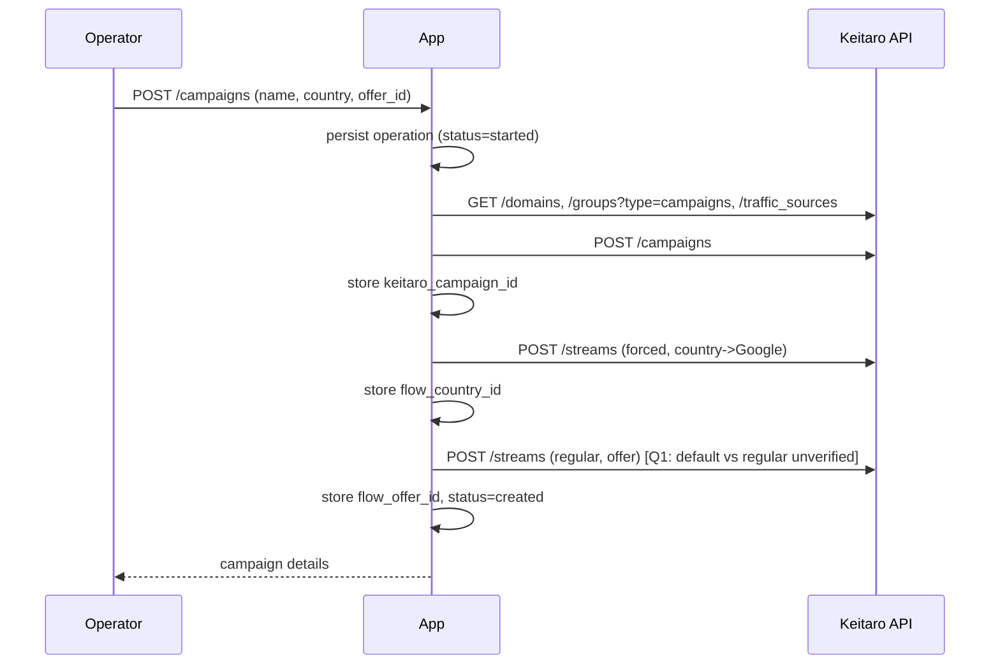
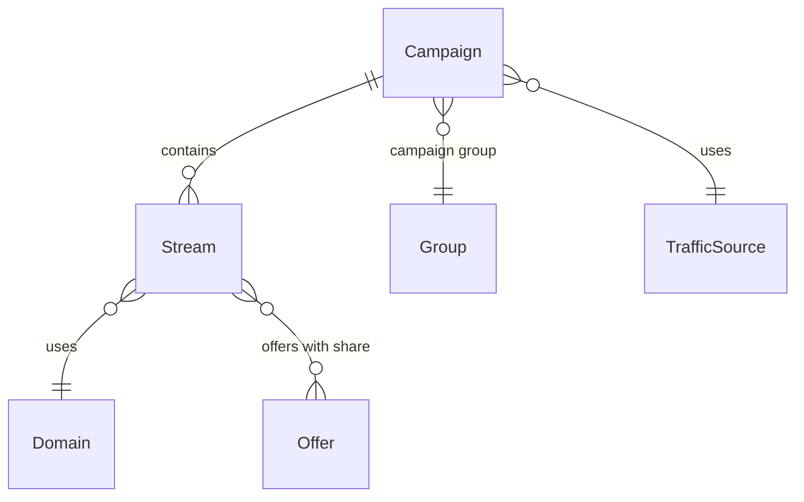

# Architecture (proposed)

## Style
Modular monolith. FastAPI app with:
- routes (HTTP)
- application services (campaign creation, offer editing)
- Keitaro client adapter
- SQLAlchemy persistence (minimal local state)

## Data ownership
Keitaro is source of truth for campaigns/streams/offers. Local DB stores minimal operational state:
- app_settings (default/configured IDs and operator choices)
- campaign_creation_operations (operation state, external IDs, step status, errors)
- offer_edit_log (optional audit)

No full campaign mirror unless a concrete use case (e.g. offline listing) justifies it.

## Boundaries
- `app/services/keitaro.py` — HTTP adapter, auth from env.
- `app/services/campaign_service.py` — orchestration.
- `app/services/offer_editor_service.py` — share arithmetic + update.
- `app/db/` — models, session.
- `app/api/routes.py` — HTTP.

## Cross-cutting
- Config via pydantic-settings (.env).
- Errors: KeitaroError translated to HTTP 502 with message.
- Retries: only for safe/idempotent operations; never blindly retry non-idempotent POST. Reconcile by re-reading state first.
- Logging: no secrets.
- Testability: Keitaro client behind interface; use fake client in tests.

## Resource selection
Domain/group/traffic source IDs are operator-configured defaults stored in app_settings, selectable via settings page. If unset, the app may suggest the first active resource but must require explicit confirmation before use.

## Sequence: create campaign (provisional; Q1 open)

## Partial failure recovery
- Operation row created before any external call.
- After each successful POST, persist returned ID immediately.
- On timeout/ambiguous POST outcome: do not retry automatically. Re-read Keitaro state (GET campaign/streams) to reconcile; mark operation `ambiguous` if unresolved.
- Statuses: started, partial, ambiguous, created, failed.

## Entity relationships

EOF