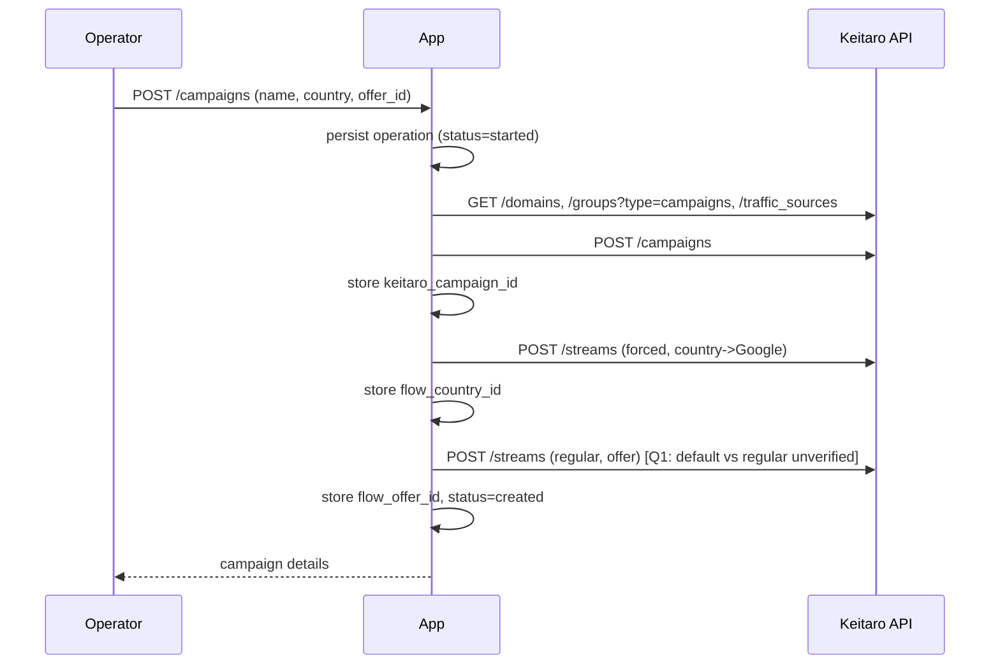
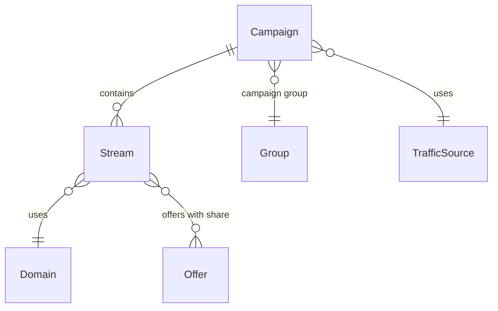

# Architecture (proposed)

## Style
Modular monolith. FastAPI app with:
- routes (HTTP)
- application services (campaign creation, offer editing)
- Keitaro client adapter
- SQLAlchemy persistence (minimal local state)

## Data ownership
Keitaro is source of truth for campaigns/streams/offers. Local DB stores minimal operational state:
- app_settings (default/configured IDs and operator choices)
- campaign_creation_operations (operation state, external IDs, step status, errors)
- offer_edit_log (optional audit)

No full campaign mirror unless a concrete use case (e.g. offline listing) justifies it.

## Boundaries
- `app/services/keitaro.py` — HTTP adapter, auth from env.
- `app/services/campaign_service.py` — orchestration.
- `app/services/offer_editor_service.py` — share arithmetic + update.
- `app/db/` — models, session.
- `app/api/routes.py` — HTTP.

## Cross-cutting
- Config via pydantic-settings (.env).
- Errors: KeitaroError translated to HTTP 502 with message.
- Retries: only for safe/idempotent operations; never blindly retry non-idempotent POST. Reconcile by re-reading state first.
- Logging: no secrets.
- Testability: Keitaro client behind interface; use fake client in tests.

## Resource selection
Domain/group/traffic source IDs are operator-configured defaults stored in app_settings, selectable via settings page. If unset, the app may suggest the first active resource as UI convenience, but must not silently use it in creation. Missing or inactive configured IDs → validation error requiring operator action.

## Reconciliation after ambiguous POST
Correlation must not rely on campaign name alone.

Proposed mechanism:
- Generate an operation-derived unique alias: `slug-<short_operation_uuid>` for the campaign. Alias is part of the campaign URL and must be unique.
- For streams: use a deterministic name including operation id and flow role (e.g. `op-<id>-country-google`).

Reconciliation steps:
1. Campaign ambiguous (POST /campaigns timed out): GET /campaigns, filter by alias. 0 matches → safe to retry creation. 1 match → adopt its id. >1 matches → keep ambiguous, require operator intervention.
2. Stream ambiguous (POST /streams timed out, campaign id known): GET /campaigns/{id}/streams, filter by name+type+schema. 0 → retry. 1 → adopt. >1 → ambiguous, operator intervention.

If safe reconciliation is impossible (multiple matches or uncertain state), keep operation `ambiguous` and require manual resolution. Never blindly retry.

## Operation state machine
States: `started`, `partial`, `ambiguous`, `created`, `failed`.

Transitions:
- started → partial: campaign created (keitaro_campaign_id known), not all streams done.
- started → created: all steps succeeded in one pass.
- started → failed: campaign creation failed (no external resource).
- partial → created: remaining streams created and verified.
- partial → ambiguous: a stream POST timed out / outcome uncertain.
- partial → failed: non-recoverable error.
- ambiguous → created: reconciliation found exactly one matching resource and completed missing steps.
- ambiguous → partial: reconciliation found 0 matches; safe to retry the missing step.
- ambiguous → failed: reconciliation impossible or operator aborted.
- created, failed: terminal (failed may be retried via a new operation).

Guarantees:
- started: no external resource confirmed.
- partial: campaign exists; some streams may exist.
- ambiguous: external state uncertain; manual reconciliation required.
- created: campaign and both flows exist and verified.
- failed: operation aborted; external resources may or may not exist (check Keitaro).

## Sequence: create campaign (provisional; Q1 open)

## Partial failure recovery
- Operation row exists before any external call.
- Persist returned IDs immediately after each successful POST.
- On timeout/ambiguous POST outcome: reconcile per algorithm above; no blind retry.
- Statuses: started, partial, ambiguous, created, failed.

## Entity relationships

EOF