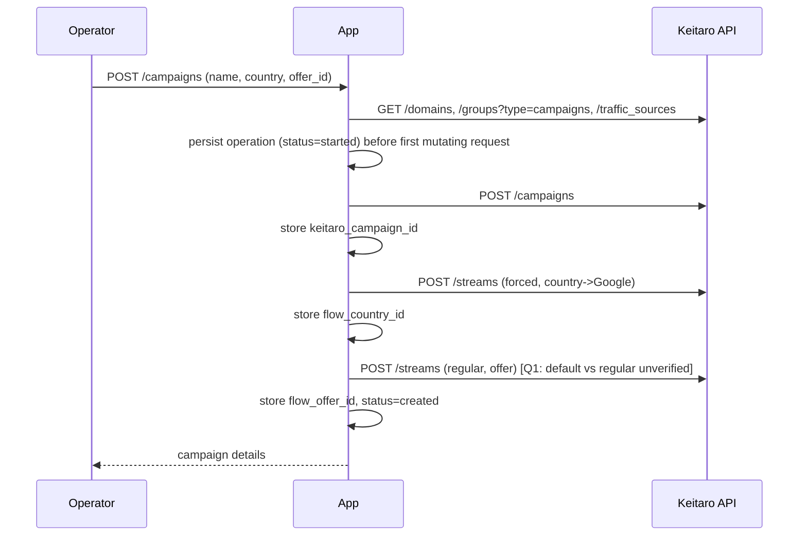
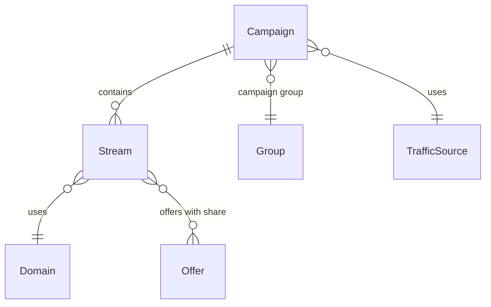

# Architecture

Cross-reference: persistence design `docs/architecture/persistence.md`, domain model `docs/spec/domain-model.md`, module boundaries `docs/implementation/module-boundaries.md`.

## Status

The dependency direction, data ownership and boundaries below are the accepted target design (`docs/decisions.md`, `docs/implementation/module-boundaries.md`). Implemented as of Slice 2: `app/main.py` (composition root and lifespan), `app/api/` (health route), `app/application/` (DTOs and `KeitaroClientPort`), `app/domain/` (pure allocation), `app/keitaro_client/` (async adapter), `app/core/` (settings), `app/db/` and `alembic/` (SQLite/Alembic with the `app_settings` table). Workflows, operation tables, reconciliation and editor behavior are target design for later slices; progress is tracked in `docs/implementation/implementation-plan.md`. Verified API observations are facts about Keitaro, not claims about implemented features.

## Style
Modular monolith. FastAPI app with:
- `app/api/` — HTTP transport (routes, schemas, errors).
- `app/application/` — workflows, DTOs and application-owned ports; DTOs and `KeitaroClientPort` exist, workflows are planned.
- `app/keitaro_client/` — Keitaro client adapter.
- `app/db/` — SQLAlchemy persistence (minimal local state).
- `app/core/` — settings from `.env`; no business logic.
- `app/main.py` — composition root.

Module roles and dependency direction are canonical in `docs/implementation/module-boundaries.md`.

## Data ownership
Keitaro is source of truth for campaigns/streams/offers. Local DB stores minimal operational state.

Implemented in Slice 0:
- `app_settings` — default/configured IDs and operator choices (model `AppSettings`).

Target design (entity names per `docs/architecture/persistence.md`; not implemented yet):
- `CampaignCreationOperation` — operation state, external IDs, step status, errors.
- `StreamOfferBinding` — committed binding lifecycle (`ACTIVE`/`ARCHIVED`), `is_pinned` and remote share cache.
- `StreamDraft` — staged changes per stream; does not overwrite committed state.
- `StreamPublication` — per-stream publication history and outcomes.

No full campaign mirror unless a concrete use case (e.g. offline listing) justifies it.

## Boundaries
- `app/main.py` — composition root: FastAPI app, lifespan-managed `httpx.AsyncClient`, adapter wiring.
- `app/api/` — transport: routes, schemas, HTTP errors.
- `app/application/` — orchestration, DTOs and ports owned by the application; adapters are not imported here.
- `app/keitaro_client/` — adapter implementing `KeitaroClientPort`; HTTP transport, auth from env.
- `app/core/` — settings from `.env`.
- `app/db/`, `alembic/` — SQLAlchemy models/session and migrations.

The pure allocation module (`app/domain/`) is implemented; domain entities and persistence repositories are target modules for later slices; see `docs/implementation/module-boundaries.md`.

## Cross-cutting
- Persistence boundary (D14): sync SQLAlchemy operations must not execute directly inside an async request path on the event loop; use FastAPI threadpool or an explicit boundary.
- HTTP transport: httpx.AsyncClient (D13). Async methods; lifespan-managed; no sync calls in async path.
- Config via pydantic-settings (.env).
- Errors (target): `KeitaroError` from the adapter translated to HTTP 502 with a message in the transport layer.
- Retries: only for safe/idempotent operations; never blindly retry non-idempotent POST. Reconcile by re-reading state first.
- Logging: no secrets.
- Testability: Keitaro client behind the application-owned `KeitaroClientPort`; current tests use `httpx.MockTransport`.

## Resource selection (target design)
Domain/group/traffic source IDs are operator-configured defaults stored in app_settings, selectable via settings page. If unset, the app may suggest the first active resource as UI convenience, but must not silently use it in creation. Missing or inactive configured IDs → validation error requiring operator action.

## Uniqueness guarantees (verified 2026-11-17)
- Campaign alias: uniqueness enforced by Keitaro (verified: duplicate alias → 422 "Alias has already used"). Application relies on this for correlation.
- Stream name: NOT unique within a campaign (verified: duplicate names accepted). Therefore application must not rely on stream name alone.
- Correlation marker: store operation id in the stream `comments` field (verified persisted and returned, and readable via GET /campaigns/{id}/streams). Reconciliation query filters on this field. This is application-level uniqueness, not Keitaro-enforced; treat as best-effort marker.

## Reconciliation after ambiguous POST (target design)
Correlation must not rely on campaign name alone.

Campaign (POST /campaigns timed out, id unknown):
- Reconcile by unique alias (Keitaro-enforced). Iterate GET /campaigns (paginated, offset/limit). 
- 0 matches after bounded attempts → remain ambiguous. Do NOT retry automatically. Bounded repeated reconciliation may be attempted, but zero results alone never authorize a retry.
- 1 match → adopt its id.
- >1 matches → impossible if alias unique; if observed, ambiguous + operator intervention.

Stream (POST /streams timed out, campaign id known):
- Reconcile by `comments` marker (operation id) via GET /campaigns/{id}/streams (field is readable and used as filter).
- 0 matches after bounded attempts → remain ambiguous (do NOT retry automatically; delayed visibility/pagination may hide a created resource).
- 1 match → adopt.
- >1 matches → ambiguous + operator intervention.
- Retry is permitted only when reliable evidence establishes that the previous external side effect did not occur, or when a documented API guarantee makes retry safe. Zero matches after bounded reconciliation are never sufficient by themselves. Incomplete pagination or uncertain read-after-write consistency cannot establish absence. Operator confirmation alone cannot establish absence. If absence cannot be reliably established, preserve `ambiguous`; do not retry.

If safe reconciliation cannot be established, keep operation `ambiguous` and require operator intervention. Never blindly retry non-idempotent POST.

## Operation state machine (target design)
States: `started`, `partial`, `ambiguous`, `created`, `failed`, `abandoned`.

Transitions:
- started → partial: campaign created (keitaro_campaign_id known), not all streams done.
- started → created: all steps succeeded in one pass.
- started → failed: campaign creation failed with a definitive error response (no campaign created).
- partial → created: remaining streams created and verified.
- partial → ambiguous: a stream POST timed out / outcome uncertain.
- partial → failed: non-recoverable error with definitive response.
- ambiguous → created: reconciliation found exactly one matching resource and completed missing steps.
- ambiguous → partial: only when reliable evidence establishes absence of the previous external side effect (or a documented API safety guarantee); ordinary zero-result reconciliation is insufficient; otherwise remains ambiguous.
- ambiguous → abandoned: operator decides to stop without establishing external outcome. Does NOT imply resources absent.
- created, failed, abandoned: terminal (failed may be retried via a new operation; abandoned leaves external state unknown).

Guarantees:
- started: no external resource confirmed.
- partial: campaign exists; some streams may exist.
- ambiguous: external state uncertain; manual reconciliation required.
- created: campaign and both flows exist and verified.
- failed: operation aborted due to a definitive error. Does NOT guarantee absence of external resources; cleanup may be required. Distinguish from ambiguous (uncertain outcome).
- abandoned: operator stopped without establishing external outcome. External resources may or may not exist; no cleanup assumption.

## Sequence: create campaign (target design, provisional; Q1 open)

## Partial failure recovery (target design)
- Operation row persisted before the first mutating external request; read-only GET resolution may precede it.
- Persist returned IDs immediately after each successful POST.
- On timeout/ambiguous POST outcome: reconcile per algorithm above; no blind retry.
- Statuses: started, partial, ambiguous, created, failed, abandoned.

## Entity relationships (target domain model)

