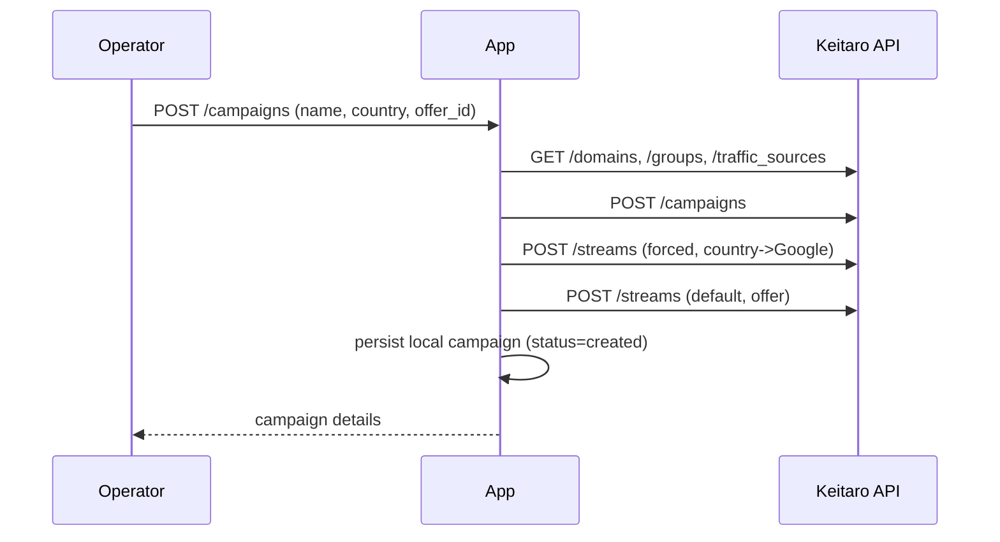
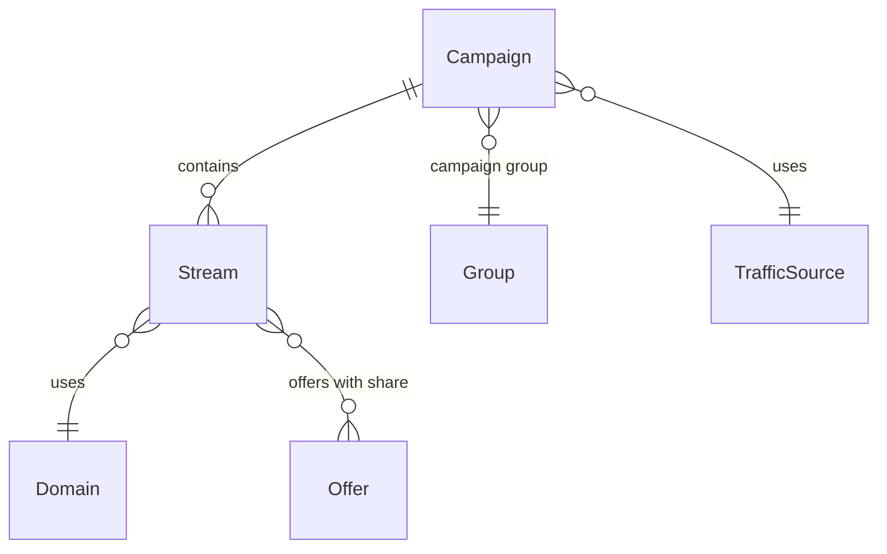

# Architecture (proposed)

## Style
Modular monolith. FastAPI app with:
- routes (HTTP)
- application services (campaign creation, offer editing)
- Keitaro client adapter
- SQLAlchemy persistence (minimal local state)

## Data ownership
Keitaro is source of truth for campaigns/streams/offers. Local DB stores:
- app_settings (default ids)
- campaigns (mirror: name, country, offer, keitaro ids, status)
- offer_edit_log (optional audit)

## Boundaries
- `app/services/keitaro.py` — HTTP adapter, auth from env.
- `app/services/campaign_service.py` — orchestration.
- `app/services/offer_editor_service.py` — share arithmetic + update.
- `app/db/` — models, session.
- `app/api/routes.py` — HTTP.

## Cross-cutting
- Config via pydantic-settings (.env).
- Errors: KeitaroError translated to HTTP 502 with message.
- Retries: simple (1 retry on 5xx/timeout) optional.
- Logging: no secrets.
- Testability: Keitaro client behind interface; use fake client in tests.

## Sequence: create campaign

## Entity relationships

EOF