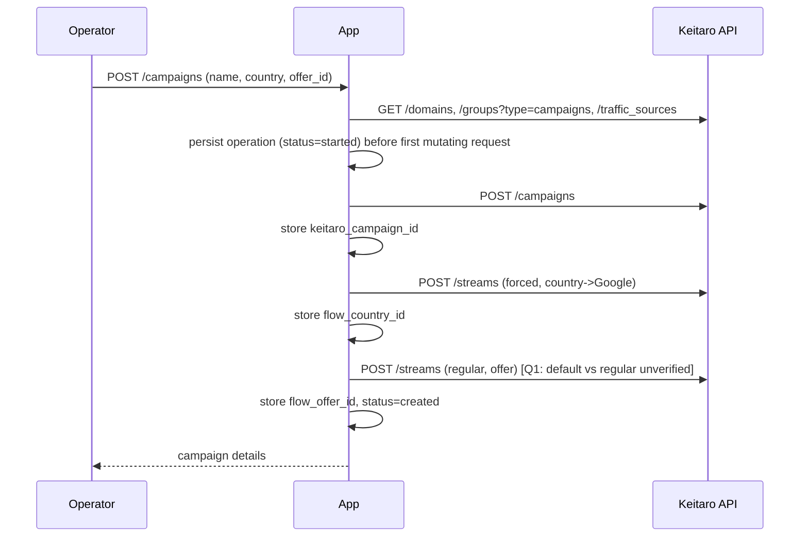
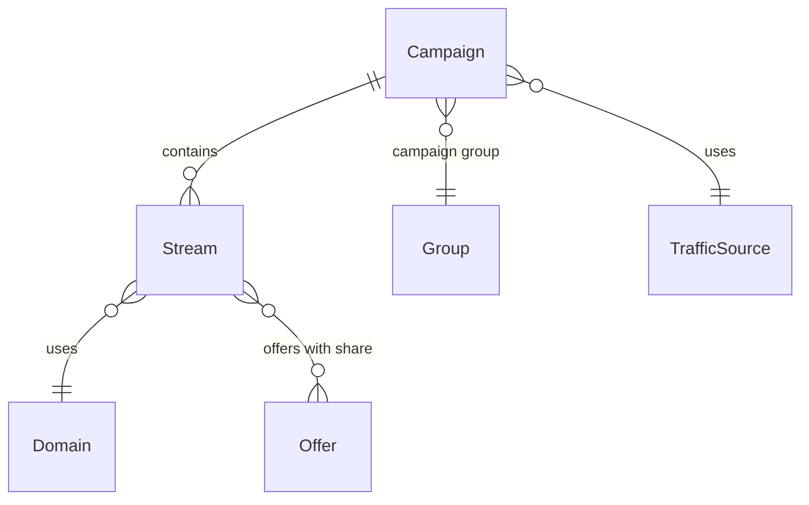

# Architecture (proposed)

## Style
Modular monolith. FastAPI app with:
- routes (HTTP)
- application services (campaign creation, offer editing)
- Keitaro client adapter
- SQLAlchemy persistence (minimal local state)

## Data ownership
Keitaro is source of truth for campaigns/streams/offers. Local DB stores minimal operational state:
- app_settings (default/configured IDs and operator choices)
- campaign_creation_operations (operation state, external IDs, step status, errors)
- offer_edit_log (optional audit)

No full campaign mirror unless a concrete use case (e.g. offline listing) justifies it.

## Boundaries
- `app/services/keitaro.py` — HTTP adapter, auth from env.
- `app/services/campaign_service.py` — orchestration.
- `app/services/offer_editor_service.py` — share arithmetic + update.
- `app/db/` — models, session.
- `app/api/routes.py` — HTTP.

## Cross-cutting
- Config via pydantic-settings (.env).
- Errors: KeitaroError translated to HTTP 502 with message.
- Retries: only for safe/idempotent operations; never blindly retry non-idempotent POST. Reconcile by re-reading state first.
- Logging: no secrets.
- Testability: Keitaro client behind interface; use fake client in tests.

## Resource selection
Domain/group/traffic source IDs are operator-configured defaults stored in app_settings, selectable via settings page. If unset, the app may suggest the first active resource as UI convenience, but must not silently use it in creation. Missing or inactive configured IDs → validation error requiring operator action.

## Uniqueness guarantees (verified 2026-11-17)
- Campaign alias: uniqueness enforced by Keitaro (verified: duplicate alias → 422 "Alias has already used"). Application relies on this for correlation.
- Stream name: NOT unique within a campaign (verified: duplicate names accepted). Therefore application must not rely on stream name alone.
- Correlation marker: store operation id in the stream `comments` field (verified persisted and returned, and readable via GET /campaigns/{id}/streams). Reconciliation query filters on this field. This is application-level uniqueness, not Keitaro-enforced; treat as best-effort marker.

## Reconciliation after ambiguous POST
Correlation must not rely on campaign name alone.

Campaign (POST /campaigns timed out, id unknown):
- Reconcile by unique alias (Keitaro-enforced). Iterate GET /campaigns (paginated, offset/limit). 
- 0 matches after bounded attempts → remain ambiguous. Do NOT retry automatically. Bounded repeated reconciliation may be attempted, but zero results alone never authorize a retry.
- 1 match → adopt its id.
- >1 matches → impossible if alias unique; if observed, ambiguous + operator intervention.

Stream (POST /streams timed out, campaign id known):
- Reconcile by `comments` marker (operation id) via GET /campaigns/{id}/streams (field is readable and used as filter).
- 0 matches after bounded attempts → remain ambiguous (do NOT retry automatically; delayed visibility/pagination may hide a created resource).
- 1 match → adopt.
- >1 matches → ambiguous + operator intervention.
- Retry of the original POST is permitted only after explicit operator confirmation or a documented API safety guarantee.

If safe reconciliation cannot be established, keep operation `ambiguous` and require operator intervention. Never blindly retry non-idempotent POST.

## Operation state machine
States: `started`, `partial`, `ambiguous`, `created`, `failed`, `abandoned`.

Transitions:
- started → partial: campaign created (keitaro_campaign_id known), not all streams done.
- started → created: all steps succeeded in one pass.
- started → failed: campaign creation failed with a definitive error response (no campaign created).
- partial → created: remaining streams created and verified.
- partial → ambiguous: a stream POST timed out / outcome uncertain.
- partial → failed: non-recoverable error with definitive response.
- ambiguous → created: reconciliation found exactly one matching resource and completed missing steps.
- ambiguous → partial: only after explicit operator confirmation that the resource does not exist (or a documented API guarantee making retry safe); reconciliation alone with 0 matches is NOT sufficient.
- ambiguous → abandoned: operator decides to stop without establishing external outcome. Does NOT imply resources absent.
- created, failed, abandoned: terminal (failed may be retried via a new operation; abandoned leaves external state unknown).

Guarantees:
- started: no external resource confirmed.
- partial: campaign exists; some streams may exist.
- ambiguous: external state uncertain; manual reconciliation required.
- created: campaign and both flows exist and verified.
- failed: operation aborted due to a definitive error. Does NOT guarantee absence of external resources; cleanup may be required. Distinguish from ambiguous (uncertain outcome).
- abandoned: operator stopped without establishing external outcome. External resources may or may not exist; no cleanup assumption.

## Sequence: create campaign (provisional; Q1 open)

## Partial failure recovery
- Operation row persisted before the first mutating external request; read-only GET resolution may precede it.
- Persist returned IDs immediately after each successful POST.
- On timeout/ambiguous POST outcome: reconcile per algorithm above; no blind retry.
- Statuses: started, partial, ambiguous, created, failed, abandoned.

## Entity relationships

