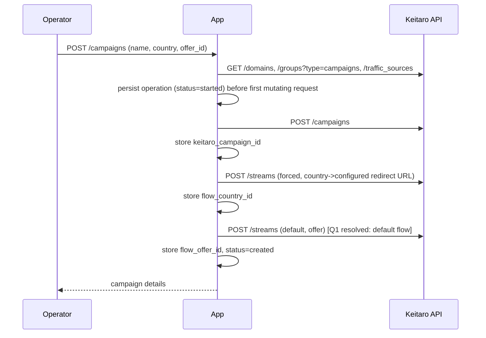
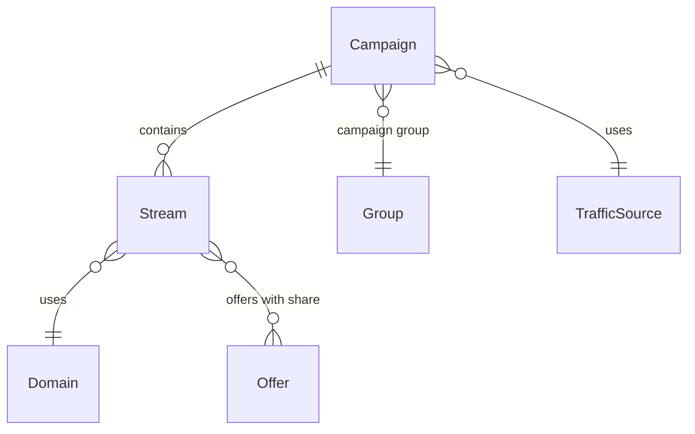

# Architecture

Cross-reference: persistence design `docs/architecture/persistence.md`, domain model `docs/spec/domain-model.md`, module boundaries `docs/implementation/module-boundaries.md`.

## Status

The dependency direction, data ownership and boundaries below are the accepted design (`docs/decisions.md`, `docs/implementation/module-boundaries.md`). Implemented as of Slice 7: `app/main.py` (composition root and lifespan), `app/api/` (routes, schemas, dependency providers and error translation), `app/application/` (DTOs, `KeitaroClientPort`, campaign creation, Fetch, local draft editing, publication and read/idempotency helpers), `app/domain/` (pure allocation, operation state machines, offer reconciliation, staged draft planning and publication eligibility/payload), `app/keitaro_client/` (async adapter), `app/core/` (settings), `app/db/` and `alembic/` (SQLite/Alembic, including `stream_publications`, with repository adapters). Later workflows are target design; progress is tracked in `docs/implementation/implementation-plan.md`. Verified API observations are facts about Keitaro, not claims about implemented features.

## Style
Modular monolith. FastAPI app with:
- `app/api/` — HTTP transport (routes, schemas, dependency providers, errors).
- `app/application/` — workflows, DTOs and application-owned ports; campaign creation, Fetch, local draft editing and publication are implemented.
- `app/keitaro_client/` — Keitaro client adapter.
- `app/db/` — SQLAlchemy persistence (minimal local state).
- `app/core/` — settings from `.env`; no business logic.
- `app/main.py` — composition root.

Module roles and dependency direction are canonical in `docs/implementation/module-boundaries.md`.

## Data ownership
Keitaro is source of truth for campaigns/streams/offers. Local DB stores minimal operational state.

Implemented in Slice 0:
- `app_settings` — default/configured IDs and operator choices (model `AppSettings`).

Implemented in Slice 3:
- `CampaignCreationOperation` — operation state, external IDs, step status, errors.

Implemented in Slice 4 (entity names per `docs/architecture/persistence.md`):
- `StreamRef` — cached remote stream identity, keyed by campaign and remote stream id.
- `RemoteSnapshot` — last observed remote offer array, ordered, with capture time; separate from any draft baseline.
- `StreamOfferBinding` — committed binding lifecycle (`ACTIVE`/`ARCHIVED`), `is_pinned` and remote share cache.
- `StreamDraft` — durable staged state with immutable offer/binding baselines; staging does not overwrite committed state.

Implemented in Slice 6:
- `StreamPublication` — per-stream publication history and outcomes, with a durable unresolved-operation gate.

No full campaign mirror unless a concrete use case (e.g. offline listing) justifies it.

## Boundaries
- `app/main.py` — composition root: FastAPI app, lifespan-managed `httpx.AsyncClient`, adapter wiring.
- `app/api/` — transport: routes, schemas, dependency providers and HTTP error translation; no direct repository or Keitaro access.
- `app/application/` — orchestration, DTOs and ports owned by the application; adapters are not imported here.
- `app/keitaro_client/` — adapter implementing `KeitaroClientPort`; HTTP transport, auth from env.
- `app/core/` — settings from `.env`.
- `app/db/`, `alembic/` — SQLAlchemy models/session and migrations.

The pure allocation, operation state machine, reconciliation, draft-planning and publication modules (`app/domain/`), and the campaign operation, stream reconciliation, draft and publication repositories (`app/db/`) are implemented; see `docs/implementation/module-boundaries.md`.

## Fetch/reconciliation (implemented Slice 4)
- `FetchService` reads all streams of a campaign once via the existing Keitaro port, validates the complete response (including campaign ownership of every returned stream and required offer fields such as `share`), then reconciles the whole snapshot in one synchronous DB transaction through `asyncio.to_thread` (D14). HTTP calls never run inside a DB transaction.
- Every stream with a non-empty `offers` array is reconciled independently (D18); streams without offers remain cached stream references. A stream that previously had local reconciliation state and now reports no offers is reconciled as a remote deletion.
- Remote additions create ACTIVE bindings, deletions archive and clear the share cache, reappearance reactivates while preserving the committed pin (D9). Duplicate `offer_id` entries in one stream fail the whole Fetch before any local write (D8).
- The remote snapshot cache, committed binding state and staged draft state are separate. Fetch writes only `is_stale` and structured `conflict_details` on an existing draft; it never changes `baseline_snapshot`, `staged_changes`, `version` or `is_dirty`, and conflicts remain sticky until explicit later-slice resolution (D17).
- That slice added no API route, Keitaro mutation, allocation orchestration or publication behavior; the Slice 7 routes only expose these application workflows.

## Local draft editing (implemented Slice 5)
- `DraftService` provides Add, Remove, Restore, Pin/Unpin, Set Share and local Cancel. It has no Keitaro client dependency; every repository call is offloaded with `asyncio.to_thread` (D14). That slice added no HTTP route or remote mutation; Slice 7 exposes the commands without changing them.
- The first effective edit lazily creates one draft from the current `RemoteSnapshot` and an immutable copy of committed lifecycle/pin state. `baseline_snapshot` and `baseline_bindings` are never rewritten; the staged view is derived from those baselines plus staged intent, never from mutable current bindings.
- `app/domain/draft.py` reuses `allocate()` from Slice 2. Pinned shares are fixed inputs, a manual share edit auto-pins (D19) with integer 0..100 validation (D20), and explicit Unpin returns the offer to redistribution. Zero/one active offers, all-pinned states and unallocated remainders are allowed and surfaced as `policy_cases`/`unallocated` (D21); Push eligibility remains a Slice 6 decision.
- Commands are conditional on `StreamDraft.version`; semantic no-ops normalise to empty intent without a version bump. A clean draft whose intent normalises to `{}` is deleted in the same transaction, and the next edit rebaselines from the current `RemoteSnapshot`. `stream_refs.draft_version_counter` keeps versions monotonic across cleanup/recreation so a stale client cannot reuse an old version. Stale drafts block editing and preserve sticky conflict data; local Cancel clears only staged intent and never resolves a conflict (D22).
- Fetch conflict detection was corrected as an S4/S5 integration fix: share changes conflict when the offer still feeds staged LRM allocation (add/archive/restore/pin intents and other offers alongside share edits), with `expected` taken from the immutable draft baseline. An offer with an explicit share edit is excluded because its local fixed share replaces the remote input; clean drafts and locally archived offers likewise have no allocation dependency.

## Publication (implemented Slice 6)
- `PublicationService` is application-owned; `app/domain/publication.py` applies D23/D24, builds the exact offers-only body and defines the durable status transitions. Persistence is behind `StreamPublicationRepository`.
- One pending operation per dirty stream is created in a transaction that re-verifies draft version, canonical staged intent and absence of an unresolved publication. A conditional claim must win before the single PUT; no DB transaction spans Keitaro I/O (D14).
- The PUT body is exactly `{"offers": [...]}`; the `GET /streams/{id}` pre-image is used only for ownership validation, stale detection and evidence. Runtime-only/response-only fields are never copied, and there is no full-document fallback.
- A PUT result is confirmed only by bounded read-back. On verified success, snapshot, bindings and draft are advanced together; failed/ambiguous outcomes retain the draft and operation evidence. All HTTP failures are ambiguous unless independent evidence establishes absence of the side effect.
- Live Keitaro writes are disabled by default (`KEITARO_ALLOW_PUBLICATION_WRITES=false`) until offers-only PUT preservation is verified live. Mocked contract tests exercise the exact request sequence; no live mutation was performed.
- Startup recovery is bounded and read-only. The hard deadline bounds the remote reconciliation phase and prevents new DB work after expiry; an already-started local transaction is awaited to completion and SQLite lock waits and connection-pool checkout waits are finite and aligned (`KEITARO_DB_BUSY_TIMEOUT`, also used as `pool_timeout`), so startup cannot hang indefinitely and no background DB transaction survives recovery. Unresolved durable rows gate new Push across all workers; read-only application functionality remains available.
- Publication Cancel is atomic: operation abandonment and draft discard commit together after version/intent revalidation.

## HTTP API (implemented Slice 7)
- Routes are thin async handlers that construct application DTOs, await one service call and serialize allowlisted response models from `app/api/schemas.py`. Repositories and the Keitaro client are never called from a route.
- Campaign creation is idempotent by a client-supplied `operation_uuid` reusing the existing durable column. Existing-key lookup and fingerprint comparison happen before config resolution/Keitaro preflight; only the atomic insert winner executes the workflow. A replay returns the existing operation without resuming it; explicit resume is a separate `200` endpoint.
- Publication reads expose a minimal allowlisted projection (`operation_uuid`, campaign/stream ids, status, draft version, effective entries, attempt count). Full stream preimages, request payloads, baselines, evidence and raw errors stay inside application/persistence.
- Push keeps independent per-stream outcomes. A typed `LIVE_WRITES_DISABLED` outcome maps to `503 PUBLICATION_WRITES_DISABLED` with the complete `PushResult`; transport never parses human-readable reasons. Ambiguous outcomes and D25 Cancel refusals remain visible with structured status/reason.
- All sync repository work remains behind the services' `asyncio.to_thread` boundaries (D14); the lifespan-managed async client is unchanged (D13).

## Frontend (implemented S8-A–S8-E)
- `frontend/` is a local/trusted SPA (Vite + React + TypeScript, React Router, TanStack Query, CSS Modules). It is a client of the wrapper API and never touches Keitaro, the database or backend internals directly.
- Screens cover durable campaign creation/recovery, campaign workspace with explicit Fetch, offer editor with versioned local draft commands, Accept-remote conflict resolution, latest publication status, status-aware publication Cancel and the bounded recovery queue. Push has no active UI path: it is exposed only as a disabled, non-interactive control with an accessible explanation, and the frontend never calls the push endpoint; `KEITARO_ALLOW_PUBLICATION_WRITES=false` remains the server fail-closed gate.
- The frontend renders server projections only: no allocation, eligibility, reconciliation or publication rules are reimplemented in the browser. See `docs/implementation/module-boundaries.md` and the approved S8 specs linked from issue #37 / #59.
- `frontend/README.md` owns the local setup, generated-contract source and API contract map; `docs/test-plan.md` records S8 unit, contract, E2E, axe and responsive coverage.

## Cross-cutting
- Persistence boundary (D14): sync SQLAlchemy operations must not execute directly inside an async request path on the event loop; use FastAPI threadpool or an explicit boundary.
- HTTP transport: httpx.AsyncClient (D13). Async methods; lifespan-managed; no sync calls in async path.
- Config via pydantic-settings (.env).
- Errors: the adapter raises the application-owned `UpstreamError` contract; transport maps it to HTTP 502 with redacted structured diagnostics. Other application/domain errors use the stable codes registered in `app/api/errors.py`.
- Retries: only for safe/idempotent operations; never blindly retry non-idempotent POST. Reconcile by re-reading state first.
- Logging: no secrets.
- Testability: Keitaro client behind the application-owned `KeitaroClientPort`; current tests use `httpx.MockTransport`.

## Resource selection (target design)
Domain/group/traffic source IDs are operator-configured defaults stored in app_settings, selectable via settings page. If unset, the app may suggest the first active resource as UI convenience, but must not silently use it in creation. Missing or inactive configured IDs → validation error requiring operator action.

## Uniqueness guarantees (verified 2026-11-17)
- Campaign alias: uniqueness enforced by Keitaro (verified: duplicate alias → 422 "Alias has already used"). Application relies on this for correlation.
- Stream name: NOT unique within a campaign (verified: duplicate names accepted). Therefore application must not rely on stream name alone.
- Correlation marker: store operation id in the stream `comments` field (verified persisted and returned, and readable via GET /campaigns/{id}/streams). Reconciliation query filters on this field. This is application-level uniqueness, not Keitaro-enforced; treat as best-effort marker.

## Reconciliation after ambiguous POST (target design)
Correlation must not rely on campaign name alone.

Campaign (POST /campaigns timed out, id unknown):
- Reconcile by unique alias (Keitaro-enforced). Iterate GET /campaigns (paginated, offset/limit). 
- 0 matches after bounded attempts → remain ambiguous. Do NOT retry automatically. Bounded repeated reconciliation may be attempted, but zero results alone never authorize a retry.
- 1 match → adopt its id.
- >1 matches → impossible if alias unique; if observed, ambiguous + operator intervention.

Stream (POST /streams timed out, campaign id known):
- Reconcile by `comments` marker (operation id) via GET /campaigns/{id}/streams (field is readable and used as filter).
- 0 matches after bounded attempts → remain ambiguous (do NOT retry automatically; delayed visibility/pagination may hide a created resource).
- 1 match → adopt.
- >1 matches → ambiguous + operator intervention.
- Retry is permitted only when reliable evidence establishes that the previous external side effect did not occur, or when a documented API guarantee makes retry safe. Zero matches after bounded reconciliation are never sufficient by themselves. Incomplete pagination or uncertain read-after-write consistency cannot establish absence. Operator confirmation alone cannot establish absence. If absence cannot be reliably established, preserve `ambiguous`; do not retry.

If safe reconciliation cannot be established, keep operation `ambiguous` and require operator intervention. Never blindly retry non-idempotent POST.

## Operation state machine (implemented for Slice 3)
States: `started`, `partial`, `ambiguous`, `created`, `failed`, `abandoned`.
Each of the three mutations also has a durable step state (`not_started`, `in_flight`,
`confirmed`, `ambiguous`); only `not_started` steps may execute a POST on resume.

Transitions:
- started → partial: campaign created (keitaro_campaign_id known), not all streams done.
- started → created: all steps succeeded in one pass.
- started → failed: campaign creation failed with a definitive error response (no campaign created).
- partial → created: remaining streams created and verified.
- partial → ambiguous: a stream POST timed out / outcome uncertain.
- partial → failed: non-recoverable error with definitive response.
- ambiguous → created: reconciliation found exactly one matching resource and completed missing steps.
- ambiguous → partial: only when reliable evidence establishes absence of the previous external side effect (or a documented API safety guarantee); ordinary zero-result reconciliation is insufficient; otherwise remains ambiguous.
- ambiguous → abandoned: operator decides to stop without establishing external outcome. Does NOT imply resources absent.
- created, failed, abandoned: terminal (failed may be retried via a new operation; abandoned leaves external state unknown).

Guarantees:
- started: no external resource confirmed.
- partial: campaign exists; some streams may exist.
- ambiguous: external state uncertain; manual reconciliation required.
- created: campaign and both flows exist and verified.
- failed: operation aborted due to a definitive error. Does NOT guarantee absence of external resources; cleanup may be required. Distinguish from ambiguous (uncertain outcome).
- abandoned: operator stopped without establishing external outcome. External resources may or may not exist; no cleanup assumption.

## Sequence: create campaign (implemented; Q1/Q2 resolved by owner in issue #26)

## Partial failure recovery (target design)
- Operation row persisted before the first mutating external request; read-only GET resolution may precede it.
- Persist returned IDs immediately after each successful POST.
- On timeout/ambiguous POST outcome: reconcile per algorithm above; no blind retry.
- Statuses: started, partial, ambiguous, created, failed, abandoned.

## Entity relationships (target domain model)

