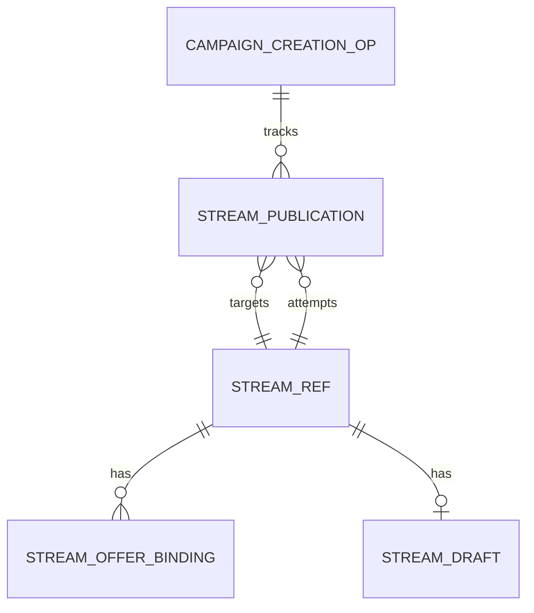

# Persistence design (PERSIST-001)

Cross-reference: domain model and workflows in SPEC-001 (`docs/spec/domain-model.md`, `docs/spec/offer-allocation.md`).

## Strategy
Snapshot-based drafts with durable binding/archive/pinning state. A single relational (SQLite) store with small tables. No full Keitaro mirror, no event log. Operation records provide recovery/audit.

Rationale: proportionate for take-home; deterministic; simpler than event sourcing; sufficient for restart recovery and partial Push.

## Ownership
- **Remote state** (Keitaro): campaigns, streams, offer arrays. Cached in `remote_snapshot` / binding `last_remote_share`.
- **Committed wrapper state**: binding lifecycle (`ACTIVE/ARCHIVED`), `is_pinned`, archive metadata.
- **Local draft state**: staged changes per stream (does not overwrite committed state until Push succeeds).
- **Publication state**: per-stream operation history/outcomes.

## ER diagram

## Entities

### CampaignCreationOperation
- id (PK), operation_uuid (unique), alias (unique, remote correlation), name, country_code, offer_id
- keitaro_campaign_id, flow_country_id, flow_offer_id (nullable remote refs)
- domain_id, group_id, traffic_source_id
- status: started|partial|ambiguous|created|failed|abandoned
- error_message (nullable)
- created_at, updated_at
Ownership: wrapper operational.

### StreamOfferBinding
- id (PK)
- stream_ref (remote stream id, integer ref; no local FK)
- offer_id
- lifecycle: ACTIVE | ARCHIVED
- is_pinned: bool (default false)
- last_remote_share: nullable int (cache)
- archived_at, reactivated_at (nullable)
- created_at, updated_at
- UNIQUE(stream_ref, offer_id) proposed (one logical binding per pair).
Ownership: committed wrapper state + remote cache.

### StreamDraft
- id (PK)
- stream_ref (unique) — one draft per stream
- baseline_snapshot (JSON) — remote offer array captured at Fetch or last successful Push
- baseline_captured_at
- staged_snapshot (JSON, nullable) — staged offer array; null = no draft/no changes
- version (wrapper-side optimistic concurrency, int)
- is_dirty (bool)
- created_at, updated_at
Ownership: local draft state (staged).

### StreamPublication
- id (PK)
- stream_ref
- campaign_creation_operation_id (nullable)
- status: pending|in_progress|succeeded|failed|ambiguous|abandoned
- attempt_count
- correlation_marker (comments value)
- request_payload (JSON, redacted)
- remote_baseline_before (JSON), remote_baseline_after (JSON, nullable)
- error (nullable)
- started_at, finished_at (nullable)
Ownership: publication state.

## Constraints
- One draft per stream (unique stream_ref).
- Binding uniqueness proposed (stream_ref, offer_id).
- No FK to remote entities; remote IDs are references.
- No full campaign/stream mirror.

## State transitions

### Binding lifecycle
- ACTIVE ↔ ARCHIVED (remove archives, bring back reactivates).
- is_pinned independent; persists across archive/reactivation (proposed, owner decision open).

### Draft
- empty → pending on any staged change.
- pending → empty on Cancel (restore baseline) or successful Push commit.
- version increments on each staged mutation (wrapper-side only).

### Publication
- pending → in_progress → succeeded | failed | ambiguous.
- ambiguous → abandoned (operator) or created/succeeded after reconciliation.
- failed may be retried via new publication record (after reconciliation if ambiguous).

## Successful Push semantics
A confirmed successful publication:
1. advances remote baseline (remote snapshot updated from Keitaro response/re-fetch);
2. commits corresponding wrapper changes (lifecycle/pin already committed? Actually lifecycle changes staged? On Push, archived offers omitted; binding lifecycle already ARCHIVED locally before push? Need define: Remove stages archive locally; Push commits by omitting from remote. Binding lifecycle becomes ARCHIVED committed after successful push? Or committed on Remove? Let's define: binding lifecycle committed on Remove staging? Hmm.
Proposed: committed wrapper state updated during staging? To survive restart, archive state must be durable. So Remove updates binding lifecycle to ARCHIVED committed immediately (durable), and draft records the staged omission. Push then publishes. Cancel of pending draft restores binding? This is tricky.

Alternative: committed state changes only after successful Push; draft holds intended lifecycle. But archive must survive restart even if not pushed? Owner says drafts/archive state survive restart. So archive state is durable. Thus binding lifecycle (committed) changes on Remove action (durable), and draft records pending push. Cancel reverts committed? That would undo durable archive. Not desired maybe.

Let's define:
- Committed binding state (lifecycle, pin) is durable wrapper state.
- Local draft captures intended remote changes (which bindings to include and shares), not lifecycle? But archive is wrapper-owned and committed immediately on Remove, while remote omission is published on Push.
- On successful Push: remote baseline advances; draft cleared/normalized; publication succeeded.
- On Cancel: discard staged share/pin edits? But archive committed? Cancel discards pending local edits and restores original state including removing staged additions. For archived offers, Cancel cannot un-archive if already committed? Demo says Cancel discards pending local changes and restores original state. So archive action may also be staged, not committed, until Push. But archive must survive restart per owner. Contradiction: if archive staged only, restart loses it unless draft durable. Draft is durable, so staged archive survives restart. Committed binding lifecycle changes only on successful Push? But then Fetch reconciliation: remote removal archives binding. For user Remove, archive could be staged in draft and committed on Push. But then archive state not durable if draft lost? Draft durable. OK.

Proposed resolution:
- Committed binding state reflects last synced/published state plus remote reconciliation.
- Local draft holds intended changes including archive/restore/pin/share.
- Push commits: on success, apply draft changes to committed binding state (archive/restore/pin/share baseline) and advance remote baseline; clear draft.
- Cancel discards draft; committed state unchanged.

This keeps committed vs staged separate. Good.

### Fetch reconciliation
Matrix (remote vs committed/draft):
- Remote offer newly appears: create ACTIVE binding (if none), last_remote_share=remote share; if draft exists, mark conflict/stale, do not overwrite draft automatically.
- Remote offer disappears: set binding ARCHIVED (committed), last_remote_share=null; if draft references it, mark conflict.
- Archived offer reappears: reactivate binding to ACTIVE, last_remote_share=remote share; pin preserved per proposal (open owner decision). If draft exists, mark conflict.
- Remote share changes: update last_remote_share; if draft has share edits for that offer, mark conflict (do not overwrite staged share).
- Repeated Fetch no changes: no-op; baseline refresh.

Conflict handling: mark draft `stale` with conflict details; require user resolution (keep draft or accept remote). Do not silently merge.

### Failure/recovery matrix
- Push timeout/ambiguous: publication status ambiguous; draft retained; reconciliation before retry.
- Some streams succeed, others fail: successful streams synced+draft cleared; failed retain draft+publication failed.
- Process restart during batch: on startup, reconcile in-progress/ambiguous publications (bounded) before allowing new Push.
- Per-stream Cancel after partial Push: discard only that stream's draft; successful remote writes remain.

### Concurrency
- StreamDraft.version optimistic concurrency: updates require expected version; stale update rejected (409).
- Binding updates use updated_at/version.
- Transaction boundaries: local DB transaction per user action (stage/cancel/push record). Keitaro calls outside transaction; reconciliation updates in separate transaction.

### Retention
- Preserve operation records and archived bindings by default.
- Optional cleanup of old succeeded publications after N days (configurable) but not required.
- No automatic deletion of archived bindings.

## Test scenarios
- Restart preserves drafts/archive/pin/publication state.
- Stale draft conflict on Fetch remote change.
- Partial Push recovery.
- Ambiguous publication reconciliation.
- Optimistic concurrency conflict.
- Cancel after partial Push.
- Reappearance reactivation.

## Decisions
- D7: Snapshot-based drafts over event log (proportionate).
- D8: (stream_ref, offer_id) unique proposed.
- D9: Pin survives archive/reactivation (proposed, owner decision open).
- D10: Committed vs staged separation.
EOF