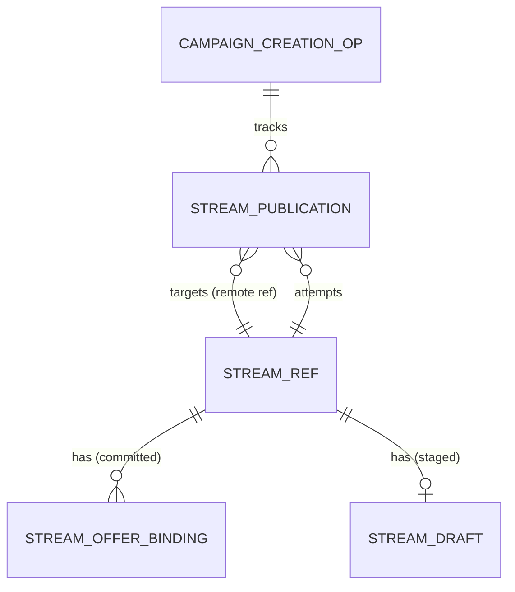

# Persistence design (PERSIST-001)

## Strategy
Snapshot-based drafts with durable committed wrapper state and durable publication history. SQLite relational store, small tables. No full Keitaro mirror, no event log.

## Ownership and state dimensions
- **Remote state** (Keitaro truth): campaign/stream config and offer arrays. Cached only.
- **Committed wrapper state**: binding lifecycle (`ACTIVE/ARCHIVED`) and `is_pinned`. Durable.
- **Local draft state**: staged changes per stream. Durable, but does not overwrite committed state until successful Push.
- **Publication state**: per-stream operation history/outcomes. Durable.

## ER diagram (logical entities; remote IDs are references, not persisted entities)

Remote entities (Campaign/Stream/Offer) are not persisted; only their IDs are stored as references.

## Entities

### CampaignCreationOperation
Fields: id, operation_uuid (unique), alias (unique, remote correlation), name, country_code, offer_id, keitaro_campaign_id, flow_country_id, flow_offer_id, domain_id, group_id, traffic_source_id, status (started|partial|ambiguous|created|failed|abandoned), error_message, created_at, updated_at.
Ownership: wrapper operational.

### StreamOfferBinding (committed)
Fields: id, stream_ref (remote id), offer_id, lifecycle (ACTIVE|ARCHIVED), is_pinned, last_remote_share (nullable cache), archived_at, reactivated_at, created_at, updated_at.
Constraint: UNIQUE(stream_ref, offer_id) proposed.
Ownership: committed wrapper state + remote cache.

### StreamDraft (staged)
Fields: id, stream_ref (unique), baseline_snapshot (JSON remote offer array), baseline_captured_at, staged_changes (JSON: additions, archives, restores, pin toggles, share edits), version (wrapper-side optimistic concurrency), is_dirty, is_stale (bool), conflict_details (JSON nullable: field, expected, observed, reason), created_at, updated_at.
Ownership: local draft state. Does not overwrite committed binding state.

### StreamPublication (publication)
Fields: id, stream_ref, campaign_creation_operation_id (nullable), status (pending|in_progress|succeeded|failed|ambiguous|abandoned), attempt_count, correlation_marker, request_payload (redacted JSON), remote_baseline_before (JSON), remote_baseline_after (JSON nullable), error, started_at, finished_at.
Ownership: publication state.

## Committed vs staged semantics
- Committed binding state (lifecycle, is_pinned) persists independently.
- Staged changes are stored in StreamDraft.staged_changes and never silently overwrite committed state.
- Cancel restores committed state by discarding staged_changes (draft becomes empty/non-dirty). Committed state unchanged.
- Confirmed Push commits staged changes to committed state and advances remote baseline.
- Failed/ambiguous Push retains draft.

## Successful Push semantics (normative)
On confirmed successful publication:
1. Remote baseline advances (remote snapshot updated from Keitaro).
2. Committed wrapper changes are applied (lifecycle/pin changes staged in draft become committed).
3. The stream's draft is cleared/normalized (staged_changes null, is_dirty false, baseline updated).
4. PublicationOperation history is preserved.
A draft is not cleared merely because an HTTP request returned success if the resulting remote state is unconfirmed; reconciliation required.

## Remote deletion vs user archive
- Remote deletion discovered by Fetch is a reconciliation event: binding lifecycle becomes ARCHIVED, last_remote_share null. It is not a user-staged archive action and does not create a draft.
- User Remove stages archive in draft; committed lifecycle changes on successful Push.

## Reconciliation
Conflicts:
- Remote offer newly appears: create ACTIVE binding (if none); update cache. If draft exists, mark draft stale (conflict details), do not overwrite staged changes.
- Remote offer disappears: set binding ARCHIVED; if draft references it, mark conflict.
- Archived offer reappears: reactivate to ACTIVE, update cache; pin preservation proposed (open). If draft exists, mark conflict.
- Remote share changes: update last_remote_share; if draft has share edits for that offer, mark conflict (do not overwrite staged share).
- Repeated Fetch no changes: no-op; baseline refresh.

Resolution: draft marked stale with conflict details; user chooses keep draft or accept remote. No silent merge.

## Publication transitions and startup recovery
States: pending → in_progress → succeeded | failed | ambiguous.
- ambiguous → abandoned (operator) or succeeded after reconciliation.
- failed may be retried via a new publication record only when reliable evidence establishes that the previous external side effect did not occur, or a documented API guarantee makes retry safe; otherwise remains ambiguous.
- Startup recovery: reconcile in-progress/ambiguous publications (bounded) before new Push. If reconciliation cannot establish the outcome, leave publication ambiguous (or abandoned on operator decision); do not assume failure.

Failed vs ambiguous:
- failed: definitive error response; does not guarantee absence of external resources.
- ambiguous: uncertain outcome; reconciliation required.
- abandoned: operator stopped without establishing outcome; external state unknown.

## comments correlation (best-effort)
- Store operation id in stream `comments` field (verified persisted/readable).
- Reconciliation filters on comments.
- Limitations: pagination completeness and read-after-write consistency not guaranteed; zero matches do not authorize retry (bounded reconciliation). Alias uniqueness enforced (verified); stream names not unique (verified).

## Retry safety
- A definitive HTTP error does not necessarily prove that no external side effect occurred.
- Retry is allowed only when reliable evidence establishes that the previous external side effect did not occur, or a documented API guarantee makes retry safe.
- If the outcome cannot be established, keep the operation ambiguous; no retry.
- Distinguish: confirmed application, confirmed absence of effect, unresolved outcome.
- Zero matches under incomplete pagination or uncertain read-after-write consistency does not establish absence.

## Concurrency
- StreamDraft.version optimistic concurrency (wrapper-side only, not Keitaro version).
- Binding updates use updated_at/version.
- Local DB transaction per user action; Keitaro calls outside transaction; reconciliation updates in separate transaction.

## Retention
- Preserve operation records and archived bindings by default.
- Optional cleanup of old succeeded publications (configurable), not required.
- No automatic deletion of archived bindings.

## Test scenarios
- Restart preserves drafts/archive/pin/publication state.
- Stale draft conflict on Fetch remote change.
- Partial Push recovery.
- Ambiguous publication reconciliation.
- Optimistic concurrency conflict.
- Cancel after partial Push.
- Reappearance reactivation.
- Remote deletion reconciliation.

## Decisions
- D7: Snapshot-based drafts over event log.
- D8: (stream_ref, offer_id) unique proposed.
- D9: Pin survives archive/reactivation (proposed, open).
- D10: Committed vs staged separation.
