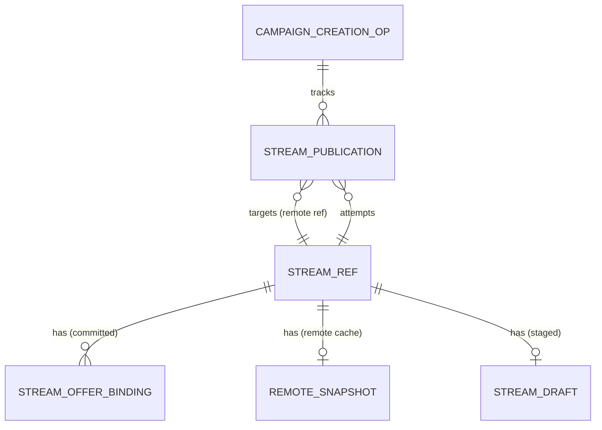

# Persistence design (PERSIST-001)

## Strategy
Snapshot-based drafts with durable committed wrapper state and durable publication history. SQLite relational store, small tables. No full Keitaro mirror, no event log.

## Ownership and state dimensions
- **Remote state** (Keitaro truth): campaign/stream config and offer arrays. Cached only.
- **Committed wrapper state**: binding lifecycle (`ACTIVE/ARCHIVED`) and `is_pinned`. Durable.
- **Local draft state**: staged changes per stream. Durable, but does not overwrite committed state until successful Push.
- **Publication state**: per-stream operation history/outcomes. Durable.

## ER diagram (logical entities; remote IDs are references, not persisted entities)

Remote entities (Campaign/Stream/Offer) are not persisted; only their IDs are stored as references.

## Entities

### CampaignCreationOperation
Fields: id, operation_uuid (unique), alias (unique, remote correlation), name, country_code, offer_id, keitaro_campaign_id, flow_country_id, flow_offer_id, domain_id, group_id, traffic_source_id, redirect_url (resolved intent, not reloaded on resume), status (started|partial|ambiguous|created|failed|abandoned), campaign_step, country_flow_step, offer_flow_step (not_started|in_flight|confirmed|ambiguous), error_message, created_at, updated_at.
Ownership: wrapper operational. Each mutating step is persisted as `in_flight` before its POST and as `confirmed` with the remote ID only after confirmation; the `not_started` → `in_flight` claim is an atomic conditional update, so only one worker may POST a step. `in_flight`/`ambiguous` steps may only reconcile on resume, and non-step `save()` calls cannot overwrite a newer step state.

### StreamRef (remote reference cache)
Fields: id, campaign_id, keitaro_stream_id, type, name, schema, comments, created_at, updated_at.
Constraint: UNIQUE(campaign_id, keitaro_stream_id); index on campaign_id. Stream names are not unique in Keitaro.
Ownership: cached Keitaro identity only. Streams without offers are retained as refs; their filters and destinations are not parsed or edited.

### RemoteSnapshot (remote cache)
Fields: id, stream_ref_id (unique FK), offers_json (ordered array of offer_id, share, state, position), captured_at.
Constraint: one current snapshot per stream; not an event log.
Ownership: last observed remote state. This cache is distinct from StreamDraft.baseline_snapshot: the draft baseline is a separate point in time owned by the staged state and is never written by Fetch.

### StreamOfferBinding (committed)
Fields: id, stream_ref_id (FK to StreamRef), offer_id, lifecycle (ACTIVE|ARCHIVED), is_pinned, last_remote_share (nullable cache), archived_at, reactivated_at, created_at, updated_at.
Constraint: UNIQUE(stream_ref_id, offer_id), accepted as D8 in issue #29. Duplicate remote offer ids in one stream fail the whole Fetch before any local write; they are never deduplicated or given occurrence-based identity.
Ownership: committed wrapper state + remote share cache. `is_pinned` is wrapper-owned and is preserved on reactivation (D9).

### StreamDraft (staged)
Fields: id, stream_ref_id (unique FK), baseline_snapshot (JSON remote offer array), baseline_bindings (JSON committed lifecycle/pin baseline at draft creation), baseline_captured_at, staged_changes (JSON intent: additions, archives, restores, pin_toggles, share_edits), version (wrapper-side optimistic concurrency), is_dirty, is_stale (bool), conflict_details (JSON nullable: field, expected, observed, reason), created_at, updated_at.
`baseline_bindings` holds `{offer_id, lifecycle, is_pinned}` from `stream_offer_bindings` at first edit; `last_remote_share` is excluded because it is a remote cache value. Together with the immutable offer baseline it makes the staged view reproducible without reading mutable committed bindings as historical data. A pre-existing draft without this baseline fails explicitly rather than falling back to current bindings.
The canonical `staged_changes` shape keeps `share_edits` as a mapping so Slice 4 conflict detection keeps working:
```json
{"additions": [9], "archives": [7], "restores": [8],
 "pin_toggles": {"8": true}, "share_edits": {"7": 55}}
```
Ownership: local draft state. Does not overwrite committed binding state. Slice 4 only prepared the table and wrote `is_stale` / `conflict_details`; Slice 5 adds lazy creation, staging commands and local Cancel.

### StreamPublication (publication)
Fields: id, stream_ref, campaign_creation_operation_id (nullable), status (pending|in_progress|succeeded|failed|ambiguous|abandoned), attempt_count, correlation_marker, request_payload (redacted JSON), remote_baseline_before (JSON), remote_baseline_after (JSON nullable), error, started_at, finished_at.
Ownership: publication state.

## Committed vs staged semantics
- Committed binding state (lifecycle, is_pinned) persists independently. Its immutable copy in `baseline_bindings` is the historical input for the staged view.
- Staged changes are stored in StreamDraft.staged_changes and never silently overwrite committed state or the remote snapshot cache.
- A manual share edit also stages `is_pinned=true` (D19). Unpin removes that pin and its fixed share so redistribution resumes.
- No-op is semantic: after applying accumulated intent, an effective state equal to the baseline normalises `staged_changes` to `{}`, `is_dirty=false`, with no version increment.
- Stale drafts (D17/D22) block editing commands; local Cancel discards staged intent only and preserves `is_stale`/`conflict_details` unchanged. It never implies conflict resolution.
- Cancel restores committed state by discarding staged_changes (draft becomes empty/non-dirty). Committed state unchanged.
- Confirmed Push commits staged changes to committed state and advances remote baseline.
- Failed/ambiguous Push retains draft.

## Successful Push semantics (normative)
On confirmed successful publication:
1. Remote baseline advances (remote snapshot updated from Keitaro).
2. Committed wrapper changes are applied (lifecycle/pin changes staged in draft become committed).
3. The stream's draft is cleared/normalized (staged_changes null, is_dirty false, baseline updated).
4. PublicationOperation history is preserved.
A draft is not cleared merely because an HTTP request returned success if the resulting remote state is unconfirmed; reconciliation required.

## Remote deletion vs user archive
- Remote deletion discovered by Fetch is a reconciliation event: binding lifecycle becomes ARCHIVED, last_remote_share null. It is not a user-staged archive action and does not create a draft. A stream that reports no offers but already has local reconciliation state is treated as a deletion; a stream that never had offers is only cached as a reference.
- User Remove stages archive in draft; committed lifecycle changes on successful Push.

## Reconciliation (Slice 4 implemented)
Keitaro calls happen before the local transaction; one whole Fetch snapshot is committed atomically. Any malformed remote data or duplicate offer id aborts the Fetch without partial local writes. Every offer-bearing stream (non-empty `offers`, not `type`) is reconciled independently (D18).

Conflicts (compared with the draft's own baseline, never with the remote snapshot cache):
- Remote offer newly appears: create ACTIVE binding (if none); update cache. If draft exists, mark draft stale (conflict details), do not overwrite staged changes.
- Remote offer disappears: set binding ARCHIVED; if draft references it, mark conflict.
- Archived offer reappears: reactivate to ACTIVE, update cache; the committed `is_pinned` value is preserved (D9). If draft exists, mark conflict.
- Remote share changes: update `last_remote_share` and the remote snapshot cache; if draft has share edits for that offer, mark conflict (do not overwrite staged share).
- Repeated Fetch no changes: no new bindings, transitions or conflict details; the remote cache capture time advances.
- Sticky conflicts (D17): `is_stale` and existing conflict details are never cleared by a later Fetch, even when the remote returns to the previous baseline. New differences are appended once; resolution belongs to a later slice.

Resolution: draft marked stale with conflict details; user chooses keep draft or accept remote in a later slice. No silent merge.

## Publication transitions and startup recovery
States: pending → in_progress → succeeded | failed | ambiguous.
- ambiguous → abandoned (operator) or succeeded after reconciliation.
- failed may be retried via a new publication record only when reliable evidence establishes that the previous external side effect did not occur, or a documented API guarantee makes retry safe; otherwise remains ambiguous.
- Startup recovery: reconcile in-progress/ambiguous publications (bounded) before new Push. If reconciliation cannot establish the outcome, leave publication ambiguous (or abandoned on operator decision); do not assume failure.

Failed vs ambiguous:
- failed: definitive error response; does not guarantee absence of external resources.
- ambiguous: uncertain outcome; reconciliation required.
- abandoned: operator stopped without establishing outcome; external state unknown.

## comments correlation (best-effort)
- Store operation id in stream `comments` field (verified persisted/readable).
- Reconciliation filters on comments.
- Limitations: pagination completeness and read-after-write consistency not guaranteed; zero matches do not authorize retry (bounded reconciliation). Alias uniqueness enforced (verified); stream names not unique (verified).

## Retry safety
- A definitive HTTP error does not necessarily prove that no external side effect occurred.
- Retry is allowed only when reliable evidence establishes that the previous external side effect did not occur, or a documented API guarantee makes retry safe.
- If the outcome cannot be established, keep the operation ambiguous; no retry.
- Distinguish: confirmed application, confirmed absence of effect, unresolved outcome.
- Zero matches under incomplete pagination or uncertain read-after-write consistency does not establish absence.

## Concurrency
- StreamDraft.version optimistic concurrency (wrapper-side only, not Keitaro version); Fetch does not change it. No draft is version 0; the first edit creates version 1, each effective edit/Cancel increments by one, and a semantic no-op does not.
- Commands carry `expected_version`; a conditional update with a mismatched version is rejected, so concurrent edits cannot overwrite each other.
- Binding identity is protected by UNIQUE(stream_ref_id, offer_id); conditional updates and a bounded local retry keep concurrent Fetches from creating duplicate rows. A losing Fetch can fail without leaving a partial snapshot.
- Local DB transaction per user action; Keitaro calls outside transaction; one complete reconciliation per Fetch transaction.

## Retention
- Preserve operation records and archived bindings by default.
- Optional cleanup of old succeeded publications (configurable), not required.
- No automatic deletion of archived bindings.

## Test scenarios
- First Fetch creates refs, ordered remote snapshot and bindings; streams without offers stay refs only.
- Remote add/delete/reappearance/share change, repeated Fetch idempotency, multi-stream isolation, duplicate-id rollback and concurrent Fetch uniqueness (Slice 4 executed).
- Stale draft conflict on Fetch remote change; staged changes, baseline, version and dirty flag stay untouched; conflict is sticky (Slice 4 executed).
- Lazy draft creation, every staging command, semantic no-op normalisation, stale-draft edit blocking with Cancel-only access, optimistic concurrency, restart durability and stream isolation (Slice 5 executed).
- Restart preserves drafts/archive/pin/publication state.
- Partial Push recovery.
- Ambiguous publication reconciliation.
- Optimistic concurrency conflict.
- Cancel after partial Push.
- Reappearance reactivation.
- Remote deletion reconciliation.

## Decisions
- D7: Snapshot-based drafts over event log.
- D8: (stream_ref, offer_id) unique binding; duplicate remote ids fail Fetch (accepted, issue #29).
- D9: Pin survives archive/reactivation (accepted, issue #29).
- D10: Committed vs staged separation.
- D17: Fetch conflicts are sticky until explicit resolution (accepted, issue #29).
- D18: All offer-bearing streams are reconciled independently (accepted, issue #29).
- D19–D22: auto-pin on manual share, integer share 0..100, surface allocation policy cases, and stale-draft edit blocking with local Cancel allowed (accepted, issue #31).
