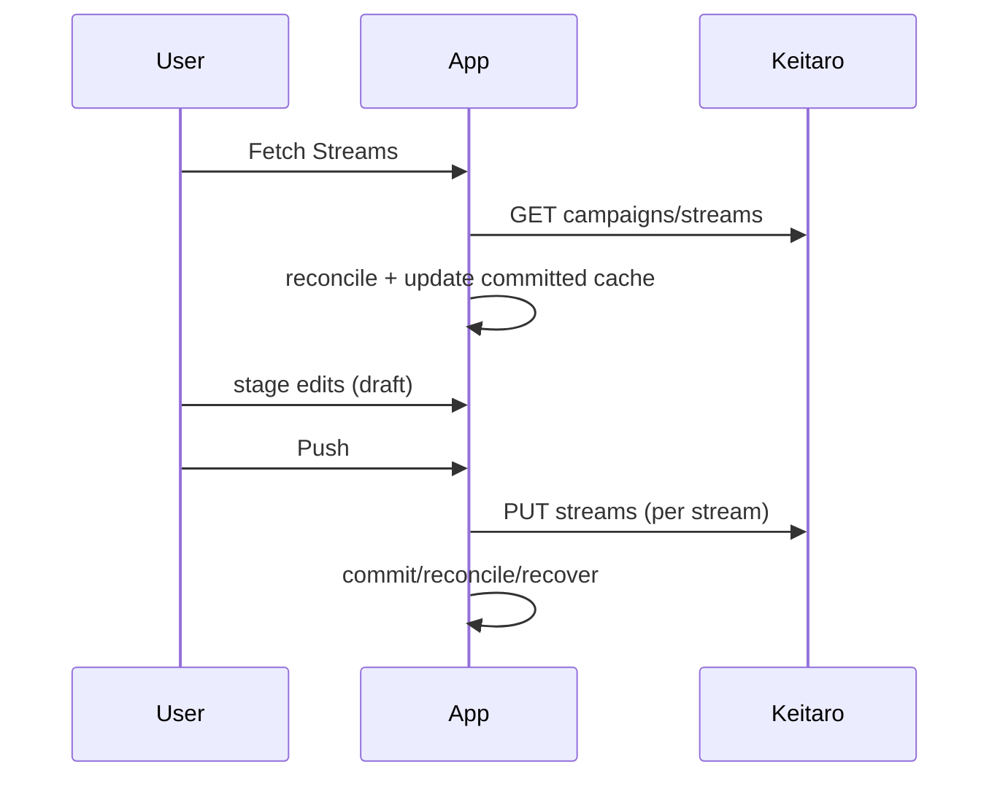

# Implementation plan (IMPLEMENTATION-001)

## Goal
Prepare first implementation milestone with dependency-ordered vertical slices. Docs-only.

## Slices

### Slice 0 — Foundation (persistence + config)
- Capability: DB schema/migrations, settings, health.
- Modules: config, persistence (models/migrations), api health.
- Tests: migration smoke, settings load.
- Completion: app starts, DB created, health ok.

### Slice 1 — Keitaro client
- Capability: typed client for domains/groups/sources/offers/campaigns/streams + discovery endpoints.
- Modules: keitaro_client.
- Tests: contract tests with mocked HTTP.
- Completion: client can list/create/read/update/delete per OpenAPI.

### Slice 2 — Allocation domain (pure)
- Capability: LRM allocation with offer_id tie-break, pinning, validation.
- Modules: domain allocation service.
- Tests: property/table-driven tests for allocation.
- Completion: deterministic allocation with worked examples.

### Slice 3 — Campaign creation workflow
- Capability: create campaign with two flows (country→Google, offer) with partial failure/reconciliation.
- Modules: application campaign service, operation persistence.
- Tests: partial failure, reconciliation, ambiguous handling.
- Completion: end-to-end campaign creation with recovery.

### Slice 4 — Fetch/reconciliation
- Capability: fetch all streams, reconcile remote offers into bindings, detect conflicts, archive/reappear.
- Modules: application fetch service.
- Tests: remote add/remove/reappear/share change, conflict detection.
- Completion: Fetch updates committed cache and marks conflicts without overwriting drafts.

### Slice 5 — Local draft editing
- Capability: stage add/remove/restore/pin/share edits per stream; Cancel restores committed.
- Modules: application draft service, persistence draft repo.
- Tests: staging without mutation, cancel, restart durability.
- Completion: drafts durable and isolated.

### Slice 6 — Push/Cancel/recovery
- Capability: batch Push per stream, partial success, ambiguous reconciliation, per-stream Cancel.
- Modules: application publication service.
- Tests: partial Push, ambiguous retry rules, startup recovery.
- Completion: recovery without blind retries.

## Decision gates
- Blocking: pinned_sum >100% (confirmed), empty offers array (open), manual share implies pinning (open), multiple offer-bearing streams (open), flow type/priority (open), Google destination (open).
- Non-blocking (provisional seam): pin preservation on reappear, allocation edge cases.

## Diagrams

## Acceptance
- Traceable to merged docs.
- First slice identifiable.
- Module responsibilities unambiguous.
- Decision gates explicit.
- Failure/restart/partial publication represented.