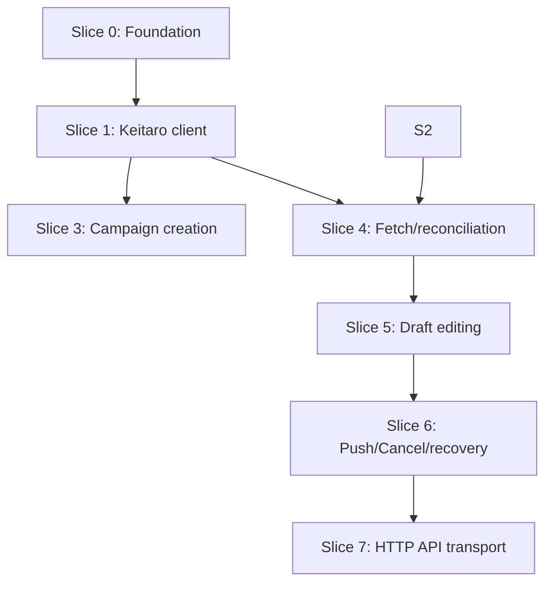
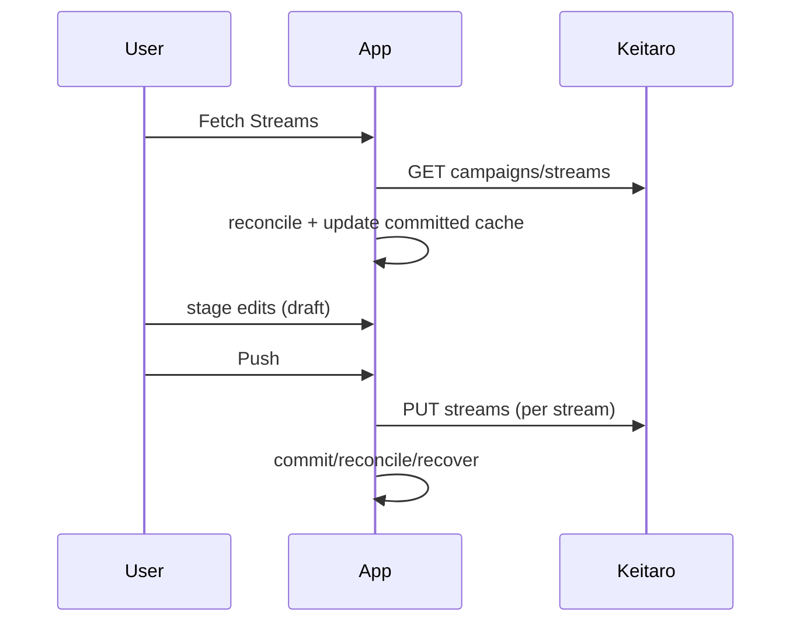

# Implementation plan (IMPLEMENTATION-001)

## Goal
Dependency-ordered vertical slices with clear boundaries. Docs-only.

## Dependency order (implementation)

Notes: Campaign creation does not depend on allocation. Fetch/reconciliation depends on Keitaro client and allocation domain (bindings), not on campaign creation.

## Slices

### Slice 0 — Foundation (bootstrap + persistence scaffolding)
- Capability: app starts, DB initialized, settings loaded, health.
- Modules: config, persistence bootstrap (engine/session), Alembic initial migration (infrastructure only), api health, composition root.
- Prerequisites: none.
- Persistence/API: bootstrap DB + settings table. Do not introduce domain tables/constraints that settle unresolved duplicate-binding policy yet.
- Tests: migration smoke, settings load, health.
- Failure cases: missing .env, invalid DB path.
- Completion: `alembic upgrade head` ok, `/health` ok.

### Slice 1 — Keitaro client
- Selected transport: async (httpx.AsyncClient). See D13.
- Capability: typed HTTP client for domains/groups/sources/offers/campaigns/streams + discovery.
- Modules: keitaro_client adapter, DTOs.
- Prerequisites: Slice 0.
- Tests: contract tests (mocked HTTP), error mapping.
- Failure cases: 401, 404, timeout, 422.
- Completion: client methods covered by tests.

### Slice 2 — Allocation domain (pure)
- Capability: LRM allocation with offer_id tie-break, pinning, validation.
- Modules: domain allocation service.
- Prerequisites: none (pure).
- Tests: property/table-driven allocation.
- Failure cases: pinned_sum > 100, zero unpinned.
- Completion: deterministic allocation tests pass.

### Slice 3 — Campaign creation workflow
- Capability: create campaign with two flows, partial failure/reconciliation.
- Modules: application campaign service, operation persistence.
- Prerequisites: Slices 0-1 (not allocation).
- Persistence: CampaignCreationOperation states.
- Tests: partial failure, reconciliation (0/1/>1), ambiguous handling.
- Failure cases: timeout, 422, ambiguous POST.
- Completion: end-to-end campaign creation with recovery.

### Slice 4 — Fetch/reconciliation (implemented, issue #29)
- Capability: fetch all streams, reconcile remote offers into bindings, detect conflicts.
- Modules: application fetch service.
- Prerequisites: Slices 0-2 (client + allocation domain for binding invariants).
- Tests: remote add/remove/reappear/share change, conflict detection, no silent overwrite.
- Completion: Fetch updates committed cache and marks conflicts.

### Slice 5 — Local draft editing (implemented, issue #31)
- Capability: stage add/remove/restore/pin/share; Cancel restores committed.
- Modules: application draft service, persistence draft repo.
- Prerequisites: Slice 4.
- Tests: staging without mutation, cancel, restart durability, optimistic concurrency.
- Completion: drafts durable and isolated.

### Slice 6 — Push/Cancel/recovery (implemented, issue #33)
- Capability: batch Push per stream, partial success, ambiguous reconciliation, per-stream Cancel, startup recovery.
- Modules: application publication service.
- Prerequisites: Slices 4-5.
- Tests: partial Push, ambiguous retry rules, startup recovery, Cancel after partial.
- Completion: recovery without blind retries.

### Slice 7 — HTTP API transport (implemented, issue #35)
- Capability: FastAPI routes and typed transport schemas for Slices 3–6, with a stable structured error contract.
- Modules: `app/api/` routes, schemas, dependency providers and error translation; application-owned read/idempotency helpers; no new business workflow.
- Prerequisites: Slices 3–6.
- Tests: route success/validation/error mapping, idempotent creation races, draft version forwarding, per-stream Push/partial success, D25 Cancel, D14 boundary, disabled-write fail-closed behavior.
- Completion: API documented; `make check` passes; no live Keitaro mutation.

## Decision gates (open unless resolved)
| Question | Status | Implementation impact |
|---|---|---|
| pinned_sum > 100% | confirmed invalid | Safely deferred (validation already specified) |
| active total == 100%? | Resolved by owner (#33): D23 A, strict 100% for Push | S6 rejects every non-100 total before any operation/PUT |
| empty offers array | Resolved by owner (#33): D24 A, reject until live verification | S6 rejects empty staged offers, including removal of the last active offer |
| manual share implies pinning? | Resolved by owner (#31): D19 A, share edit auto-pins; explicit Unpin returns to redistribution | S5 stages the pin with the share edit |
| pin preservation on reappear | Resolved by owner (#29): D9 A, preserve `is_pinned` on reactivation | S4 preserves committed pin |
| duplicate bindings | Resolved by owner (#29): D8 A, UNIQUE(stream_ref, offer_id) and explicit whole-Fetch failure on duplicate remote offer ids | S4 fails before any local write; no occurrence-based identity |
| zero/one active offers | Resolved for staging by owner (#31): D21 B, allow and surface `policy_cases`; Push policy remains S6 | S5 does not block these states |
| all-pinned remainder | Resolved for staging by owner (#31): D21 B, surface `unallocated`; Push policy remains S6 | S5 does not normalise or discard the remainder |
| manual pinned-share changes | Resolved by owner (#31): D19/D20, integer 0..100, auto-pin, invalid input rejected before write | S5 validates input and stages fixed share + pin |
| editing a stale/conflicted draft | Resolved by owner (#31): D22 B, edits blocked, local Cancel allowed, conflict data preserved | S5 rejects edits on stale drafts but permits local discard |
| duplicate archived offers | Resolved by owner (#29): same as duplicate bindings, Fetch fails explicitly | S4 rejects any duplicate offer id in one remote stream |
| remote share changes during draft | Resolved by owner (#29): cache/baseline update plus sticky conflict marker, no staged overwrite | S4 writes only `is_stale` and `conflict_details` |
| Cancel after partial Push | Resolved by owner (#33): D25 A, reconcile-first; failed requires absence evidence | S6 publication Cancel is distinct from local draft Cancel |
| Disabled live writes on Push API | Resolved by owner (#35): typed `LIVE_WRITES_DISABLED` → `503` | S7 keeps fail-closed response with the full `PushResult` |
| multiple offer-bearing streams | Resolved by owner (#29): independent per-stream reconciliation; non-empty offers array defines offer-bearing | S4 has no designated target or selection policy |
| flow type/priority | Resolved by owner (#26): offer flow uses `default` | S3 implements two flows without a priority field |
| Google destination fixed/configurable | Resolved by owner (#26): configurable setting, Google default | S3 uses `KEITARO_REDIRECT_URL`, no UI |

## Retry safety
- Automatic retries may be used for safe read-only requests.
- Mutating requests must follow publication/reconciliation policy; never blindly retry ambiguous POST/PUT outcomes.

## Recovery mapping
- Restart during in-progress publication: Slice 6 startup reconciliation.
- Partial Push: Slice 6 per-stream outcomes.
- Ambiguous HTTP outcome: reconciliation before retry (Slices 3/6).
- Incomplete reconciliation: bounded retries, ambiguous if unresolved.
- Remote changes during draft: conflict detection in Slice 4/5.
- Retry authorization: only when reliable evidence establishes absence of the previous external side effect, or a documented API guarantee makes retry safe. Zero-result reconciliation alone is insufficient.

## Diagrams

Runtime lifecycle:

## Acceptance
- Traceable to merged docs.
- First slice identifiable.
- Module responsibilities unambiguous.
- Decision gates explicit.
- Failure/restart/partial publication represented.