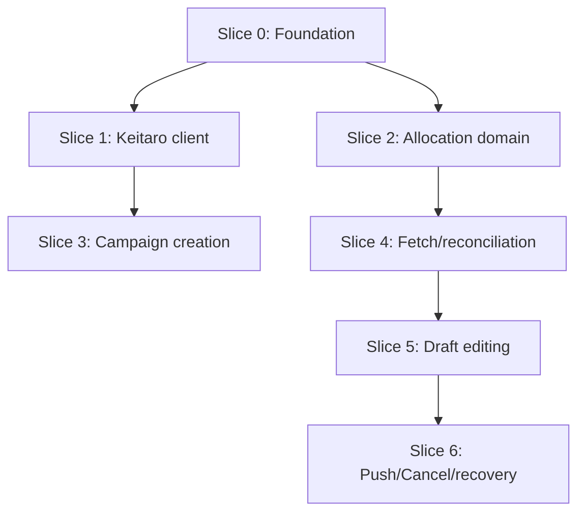
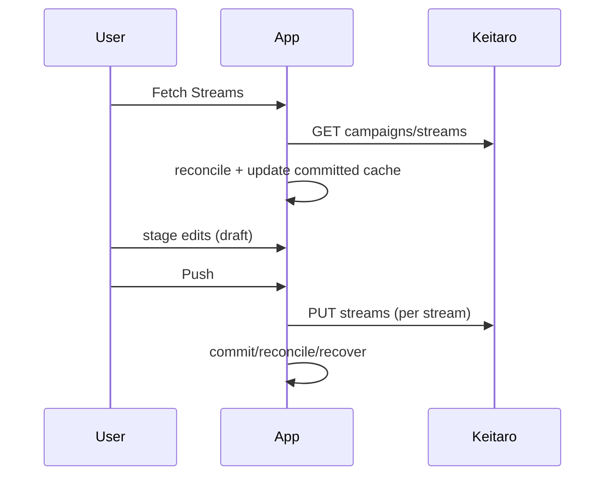

# Implementation plan (IMPLEMENTATION-001)

## Goal
Dependency-ordered vertical slices with clear boundaries. Docs-only.

## Dependency order (implementation)

## Slices

### Slice 0 — Foundation (persistence + config + composition)
- Capability: app starts, DB migrated, settings loaded, health.
- Modules: config, persistence models/migrations, composition root, api health.
- Prerequisites: none.
- Persistence/API: Alembic initial migration; settings table.
- Tests: migration smoke, settings load, health.
- Failure cases: missing .env, DB path invalid.
- Completion: `alembic upgrade head` ok, `/health` ok.

### Slice 1 — Keitaro client
- Capability: typed HTTP client for domains/groups/sources/offers/campaigns/streams + discovery.
- Modules: keitaro_client adapter, DTOs.
- Prerequisites: Slice 0.
- Tests: contract tests (mocked HTTP), error mapping.
- Failure cases: 401, 404, timeout, 422.
- Completion: client methods covered by tests.

### Slice 2 — Allocation domain (pure)
- Capability: LRM allocation with offer_id tie-break, pinning, validation.
- Modules: domain allocation service.
- Prerequisites: none (pure).
- Tests: property/table-driven allocation.
- Failure cases: pinned_sum > 100, zero unpinned.
- Completion: deterministic allocation tests pass.

### Slice 3 — Campaign creation workflow
- Capability: create campaign with two flows, partial failure/reconciliation.
- Modules: application campaign service, operation persistence.
- Prerequisites: Slices 0-2 + Keitaro client.
- Persistence: CampaignCreationOperation states.
- Tests: partial failure at each step, reconciliation (0/1/>1), ambiguous handling.
- Failure cases: timeout, 422, ambiguous POST.
- Completion: end-to-end creation with recovery.

### Slice 4 — Fetch/reconciliation
- Capability: fetch all streams, reconcile remote offers into bindings, detect conflicts.
- Modules: application fetch service.
- Prerequisites: Slices 0-3.
- Tests: remote add/remove/reappear/share change, conflict detection, no silent overwrite.
- Completion: Fetch updates committed cache and marks conflicts.

### Slice 5 — Local draft editing
- Capability: stage add/remove/restore/pin/share; Cancel restores committed.
- Modules: application draft service, persistence draft repo.
- Prerequisites: Slice 4.
- Tests: staging without mutation, cancel, restart durability, optimistic concurrency.
- Completion: drafts durable and isolated.

### Slice 6 — Push/Cancel/recovery
- Capability: batch Push per stream, partial success, ambiguous reconciliation, per-stream Cancel, startup recovery.
- Modules: application publication service.
- Prerequisites: Slices 4-5.
- Tests: partial Push, ambiguous retry rules, startup recovery, Cancel after partial.
- Completion: recovery without blind retries.

## Decision gates (open unless resolved)
| Question | Blocks | Seam/defer |
|---|---|---|
| pinned_sum > 100% | S2/S6 | confirmed invalid |
| active total == 100%? | S6 | provisional seam |
| empty offers array | S3/S6 | defer (verify API) |
| manual share implies pinning? | S5 | seam |
| pin preservation on reappear | S4 | seam |
| duplicate bindings | S4/S5 | seam |
| multiple offer-bearing streams | S4/S5/S6 | seam |
| flow type/priority | S3 | seam (keep open) |
| Google destination fixed/configurable | S3 | seam |

## Recovery mapping
- Restart during in-progress publication: Slice 6 startup reconciliation.
- Partial Push: Slice 6 per-stream outcomes.
- Ambiguous HTTP outcome: reconciliation before retry (Slices 3/6).
- Incomplete reconciliation: bounded retries, ambiguous if unresolved.
- Remote changes during draft: conflict detection in Slice 4/5.
- Retry authorization: only after absence confirmed.

## Diagrams

Runtime lifecycle:

## Acceptance
- Traceable to merged docs.
- First slice identifiable.
- Module responsibilities unambiguous.
- Decision gates explicit.
- Failure/restart/partial publication represented.